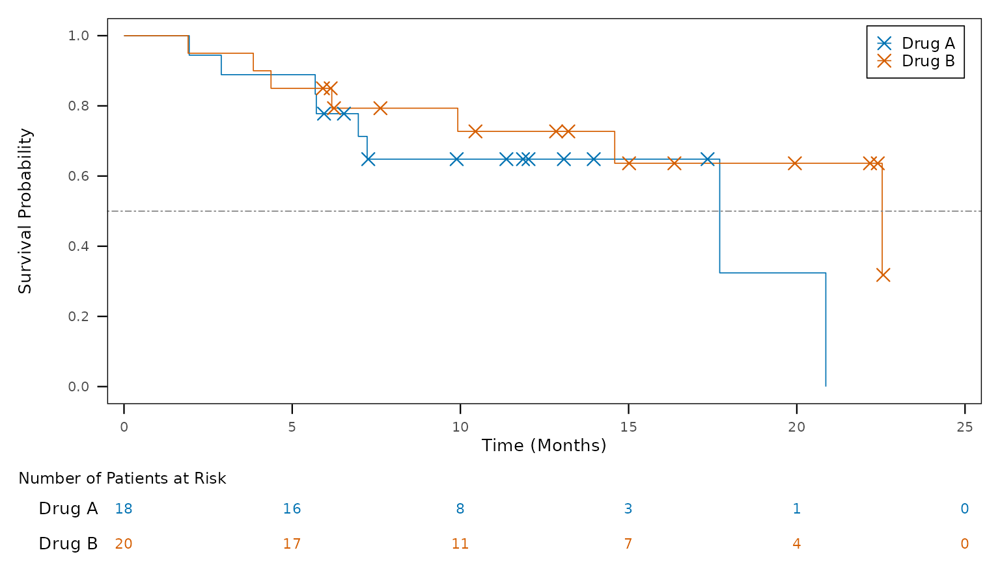

# Figures

A figure is a **design**, kept as a YAML file: one ordered list of steps
from ADaM to what is drawn (the plot’s data, and the objects made from
it: a Kaplan-Meier fit, summary statistics …), the figure-wide settings,
and the layers drawn, in order.
[`tfl_fig_design_code()`](https://ichirio.github.io/tflspec/reference/tfl_fig_design.md)
writes the ggplot2 script it stands for. The script depends on dplyr and
ggplot2 (and ggsurvfit / patchwork where a layer needs them), not on
tflspec: it is the program a study keeps, to read and finish by hand. It
is written in the style of a study’s other programs: it has two
sections, `# ---- data ----` (one `|>` pipe an object) and
`# ---- plot ----` (the palette, then one `+` chain into the figure).

``` r

library(tflspec)
adam <- tfl_example_adam()   # simulated ADaM: ADSL, ADTTE, ADRS, ADLB ...
```

## Start from a template

[`tfl_fig_templates()`](https://ichirio.github.io/tflspec/reference/tfl_fig_templates.md)
lists the templates, each with its clinical category and the data it
reads:

``` r

tp <- tfl_fig_templates()
knitr::kable(head(tp[, c("template", "category", "data", "label")], 12))
```

| template | category | data | label |
|:---|:---|:---|:---|
| km_risk_table | Efficacy: time to event | ADTTE | KM curves + number at risk |
| km_simple | Efficacy: time to event | ADTTE | KM curves |
| km_ci | Efficacy: time to event | ADTTE | KM curves + confidence bands + number at risk |
| km_single_arm | Efficacy: time to event | ADTTE | One KM curve + number at risk |
| waterfall_response | Efficacy: tumour response | ADTR + ADRS | Waterfall, bars by best response |
| waterfall_plain | Efficacy: tumour response | ADTR | Waterfall |
| swimmer_bar | Efficacy: tumour response | ADSL | Swimmer: bars + ongoing arrows |
| swimmer_response | Efficacy: tumour response | ADSL + ADRS | Swimmer: bars by best response + ongoing arrows |
| swimmer_assessment | Efficacy: tumour response | ADSL + ADRS | Swimmer: bars by best response + response at each assessment |
| swimmer_full | Efficacy: tumour response | ADSL + ADRS | Swimmer: bars, assessments, event markers, ongoing arrows |
| individual_spider | Efficacy: tumour response | ADTR + ADRS | Spider: % change in tumour size per subject, by best response |
| bar_rate_ci | Efficacy: subgroups and rates | ADRS + ADSL | Response rate by group with 95% CI |

``` r

design <- tfl_fig_template("km_risk_table", param = "OS", group = "TRT01P")
tfl_check_fig_design(design, adam)   # 0 rows: the data has what it reads
#> [1] part    field   problem
#> <0 rows> (or 0-length row.names)
```

## The design as YAML

[`tfl_write_fig_design()`](https://ichirio.github.io/tflspec/reference/tfl_fig_design.md)
writes one `.yml` a figure;
[`tfl_read_fig_design()`](https://ichirio.github.io/tflspec/reference/tfl_fig_design.md)
reads it back. It reads top to bottom as the figure is made:

``` r
yml <- tfl_write_fig_design(design, file.path(tempdir(), "F-14-2-1.yml"))
cat(readLines(yml), sep = "\n")
template: km_risk_table
data:
- step: read
  dataset: ADTTE
- step: param
  value: OS
- step: flag
  variable: FASFL
- step: time_unit
  variable: AVAL
  unit: months
- step: survfit
  name: fit
  time: AVAL
  censor: CNSR
  by: TRT01P
plot:
  x_label: Time (Months)
  y_label: Survival Probability
  colour_by: TRT01P
  palette: treatment
  legend: inside
  x_min: 0.0
  y_min: 0.0
  y_max: 1.0
  y_by: 0.2
  dpi: 300.0
  base_size: 10.0
  theme: boxed
layers:
- layer: km_curve
  linewidth: 0.3
- layer: censor_mark
  shape: x
  size: 3.0
  stroke: 0.6
- layer: hline
  yintercept: 0.5
  linetype: twodash
  colour: grey50
  linewidth: 0.3
- layer: risk_table
  title: Number of Patients at Risk
  size: 3.0
  height: 0.167
```

- `data` steps: `read`, `join`, `param`, `flag`, `filter`, `derive`,
  `time_unit`, `levels`, `rank`; the steps that make an object of their
  own (`name`): `survfit`, `summary`, `summary_by`, `rate`, `count`,
  `subset`, `ard_stats`; and `code`. A step after one of these changes
  that object, in its pipe (a design written before 0.0.24.9074, with a
  `stats:` list, reads as the one list);
- `layers`: layers of the catalog
  ([`tfl_fig_parts()`](https://ichirio.github.io/tflspec/reference/tfl_fig_parts.md)
  lists every piece and field), any `geom` by name, a `call` to any
  function, `layer_code`;
- raw R inside a value is the `!r` tag (`tfl_fig_r()` in R).

## The script

``` r

code <- tfl_fig_design_code(design, "F-14-2-1")
cat(code, sep = "\n")
# F-14-2-1: km_risk_table
# Generated by tflspec 0.0.24.9154 from the figure's design.

library(dplyr)
library(ggplot2)
library(ggsurvfit)
library(patchwork)

# the days in a week, a month, a year (the study's setup may set them)
if (!exists("days_per_month")) days_per_month <- 30.4375

# ---- data ------------------------------------------------------------------
# Input data frames: adtte

adtte_os <- adtte |>
  filter(PARAMCD == "OS", FASFL == "Y") |>
  # days -> months
  mutate(AVAL = AVAL / days_per_month)

fit <- survfit2(Surv(AVAL, CNSR == 0) ~ TRT01P, data = adtte_os)

x_breaks <- pretty(c(0, max(fit$time)))

# the number at risk at the x axis's breaks, from the fit
sr <- summary(fit, times = x_breaks, extend = TRUE)
risk <- data.frame(
  time   = sr$time,
  strata = sub("^[^=]*=", "", as.character(sr$strata)),
  n_risk = sr$n.risk
) |>
  mutate(strata = factor(strata, levels = rev(levels(factor(adtte_os$TRT01P)))))

# ---- plot ------------------------------------------------------------------
# the treatment palette, a colour for each TRT01P
lv <- levels(factor(adtte_os$TRT01P))
pal <- setNames(rep_len(c("#0072B2", "#D55E00", "#009E73", "#CC79A7", "#E69F00", "#56B4E9"), length(lv)), lv)

fig <- ggsurvfit(fit, linewidth = 0.3) +
  add_censor_mark(shape = 4, size = 3, stroke = 0.6) +
  geom_hline(yintercept = 0.5, linetype = "twodash", colour = "grey50",
             linewidth = 0.3) +
  scale_colour_manual(values = pal, breaks = names(pal)) +
  scale_x_continuous(
    breaks = x_breaks,
    expand = expansion(mult = c(0.02, 0.02))
  ) +
  scale_y_continuous(breaks = seq(0, 1, by = 0.2)) +
  coord_cartesian(xlim = range(x_breaks), ylim = c(0, 1)) +
  labs(x = "Time (Months)", y = "Survival Probability") +
  theme_minimal(base_size = 10) +
  theme(
    axis.title        = element_text(size = 10),
    axis.text         = element_text(size = 8),
    legend.text       = element_text(size = 9),
    legend.key.size   = unit(0.7, "lines"),
    panel.border      = element_rect(colour = "black", fill = NA, linewidth = 0.5),
    panel.grid        = element_blank(),
    axis.ticks        = element_line(linewidth = 0.4),
    axis.ticks.length = unit(2, "mm")
  ) +
  theme(
    legend.position        = "inside",
    legend.position.inside = c(0.98, 0.98),
    legend.justification   = c(1, 1),
    legend.background      = element_rect(colour = "black", fill = "white", linewidth = 0.3),
    legend.title           = element_blank()
  )

p_risk <- ggplot(risk, aes(x = time, y = strata, label = n_risk, colour = strata)) +
  geom_text(size = 3) +
  scale_colour_manual(values = pal, guide = "none") +
  scale_x_continuous(
    breaks = x_breaks,
    expand = expansion(mult = c(0.02, 0.02))
  ) +
  coord_cartesian(xlim = range(x_breaks), clip = "off") +
  labs(title = "Number of Patients at Risk", x = NULL, y = NULL) +
  theme_void(base_size = 10) +
  theme(
    plot.title          = element_text(hjust = 0, size = rel(0.9)),
    plot.title.position = "plot",
    axis.text.y         = element_text(hjust = 1, margin = margin(r = 5))
  )

fig <- fig / p_risk + plot_layout(heights = c(0.833, 0.167))

fig

# ---- saving the figure -----------------------------------------------------
fig_path   <- file.path("output", "F-14-2-1.png")
fig_width  <- 7.5
fig_height <- 4.5
fig_dpi    <- 300
fig_units  <- "in"

dir.create(dirname(fig_path), showWarnings = FALSE, recursive = TRUE)
ggsave(
  filename = fig_path,
  plot     = fig,
  width    = fig_width,
  height   = fig_height,
  dpi      = fig_dpi,
  units    = fig_units
)
```

Run it where the datasets are (here, objects named as the datasets in
lower case), and it draws and saves the figure:

``` r

env <- list2env(setNames(adam, tolower(names(adam))))
old <- setwd(tempdir())
eval(parse(text = code), envir = env)
setwd(old)
env$fig
```



## In a study’s programs

Three arguments fit the script into a study’s other programs:

- `setup = TRUE` takes the palette from the study’s figure setup
  (`tfl_colours()`, see *One look for the study* below) instead of
  writing it in the script;
- `save = FALSE` leaves out the PNG: a report program places the figure
  itself;
- `name` is what the figure is called (`"plot"`, for a report program
  that hands it to rtfreporter).

``` r

code <- tfl_fig_design_code(design, "F-14-2-1", setup = TRUE, save = FALSE,
                            name = "plot")
cat(code[grep("tfl_colours|^plot <-|ggsave", code)], sep = "\n")   # no ggsave()
pal <- tfl_colours("treatment", levels(factor(adtte_os$TRT01P)))
plot <- ggsurvfit(fit, linewidth = 0.3) +
plot <- plot / p_risk + plot_layout(heights = c(0.833, 0.167))
```

## When the design cannot say it

What a template’s fields cannot express is written **in the design**,
not patched into the script afterwards:

- a `code` step: R that reworks `df` or makes an object of its own;
- a `layer_code` layer: R added to the plot `p`;
- `plot.add`: calls written after the figure’s settings
  ([`theme()`](https://ggplot2.tidyverse.org/reference/theme.html),
  `scale_*()`, `facet_*()`);
- `!r` values: `labels: !r scales::label_percent()`.

Written in the style of the script, with `|>`:

``` r

arms <- "df <- df |> mutate(TRT01P = factor(TRT01P, sort(unique(TRT01P))))"
cutoff <- paste('p <- p + annotate("text", x = 1, y = 0.05,',
                'label = "Data cut-off: 01JUN2026", hjust = 0, size = 3)')
design$data <- append(design$data, list(list(step = "code", code = arms)),
                      after = 3)   # after the read, param and flag steps
design$layers <- c(design$layers,
                   list(list(layer = "layer_code", code = cutoff)))
code <- tfl_fig_design_code(design, "F-14-2-1")
cat(code[grep("your code|TRT01P = factor|Data cut-off", code)], sep = "\n")
adtte_os <- adtte_os |> mutate(TRT01P = factor(TRT01P, sort(unique(TRT01P))))
p <- p + annotate("text", x = 1, y = 0.05, label = "Data cut-off: 01JUN2026", hjust = 0, size = 3)
```

## One look for the study

[`tfl_fig_style()`](https://ichirio.github.io/tflspec/reference/tfl_fig_style.md)
holds every look-and-feel value of a study’s figures (fonts, palettes,
line widths, the legend); a study sets its own with
`options(tflspec.fig_style = tfl_read_fig_style(path))`, starting from
[`tfl_fig_style_template()`](https://ichirio.github.io/tflspec/reference/tfl_fig_style.md).
[`tfl_fig_setup_code()`](https://ichirio.github.io/tflspec/reference/tfl_fig_setup_code.md)
writes the same values as a setup script the figure programs source.

``` r

names(tfl_fig_style())
#> [1] "settings" "colors"   "markers"
```

A time on a figure’s axis is divided by a named constant, not by a
number in each program: `mutate(AVAL = AVAL / days_per_month)`, with
`days_per_week`, `days_per_month` and `days_per_year`. The study’s setup
sets them;
[`tfl_fig_setup_code()`](https://ichirio.github.io/tflspec/reference/tfl_fig_setup_code.md)
defines each one that is not defined yet, with the values of
[`tfl_time_unit_days()`](https://ichirio.github.io/tflspec/reference/tfl_time_unit_days.md).

``` r

tfl_time_unit_days()
#>  days_per_week days_per_month  days_per_year 
#>         7.0000        30.4375       365.2500
```

## A forest plot from the figure’s own ARD

The `forest_hr` template draws hazard ratios that are statistics of an
ARD – one Cox model of all subjects and one within each subgroup, made
by cards / cardx – rather than fitting the models in the figure program.
`tfl_fig_template("forest_hr", subgroups = , comparison = )` gives the
design, and `attr(design, "analyses")` the analyses the ARD needs
([`tfl_fig_forest_analyses()`](https://ichirio.github.io/tflspec/reference/tfl_fig_forest_analyses.md)),
ready for the ARD spec. Its text columns (N, the estimate and its
interval) are a panel at the right of the plot.

## Composed figures and ggplot2 versions

A design may hold several plots (`plots:`) and a patchwork layout
(`compose: {layout: km | box}`). `ggplot2_version: "3.5"` or `"4.0"`
writes the script for that version
([`tfl_fig_compat()`](https://ichirio.github.io/tflspec/reference/tfl_fig_compat.md)
lists the differences), and
[`tfl_fig_calls()`](https://ichirio.github.io/tflspec/reference/tfl_fig_calls.md)
lists the extension functions a `call` layer may name.

## The older figure spec

The sheet-based figure spec
([`tfl_fig_spec()`](https://ichirio.github.io/tflspec/reference/tfl_fig_spec.md),
[`tfl_fig_code()`](https://ichirio.github.io/tflspec/reference/tfl_fig_code.md))
and the quick figures
([`tfl_fig_km()`](https://ichirio.github.io/tflspec/reference/tfl_fig_km.md),
[`tfl_fig_waterfall()`](https://ichirio.github.io/tflspec/reference/tfl_fig_waterfall.md),
…,
[`tfl_fig_catalog()`](https://ichirio.github.io/tflspec/reference/tfl_fig_catalog.md))
remain while the development team decides between the two ([Discussion
\#63](https://github.com/ichirio/tflspec/discussions/63)); new work
should use the design.
